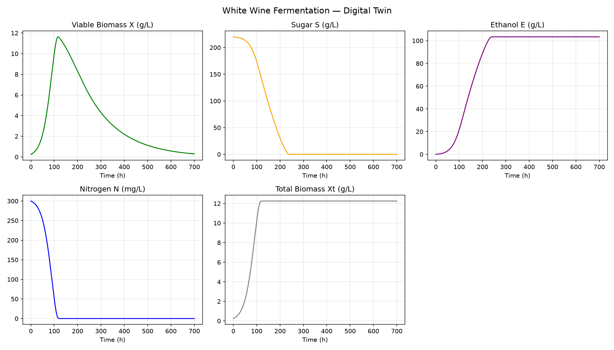
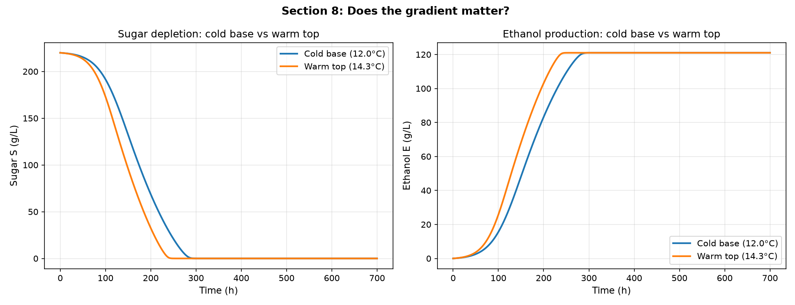
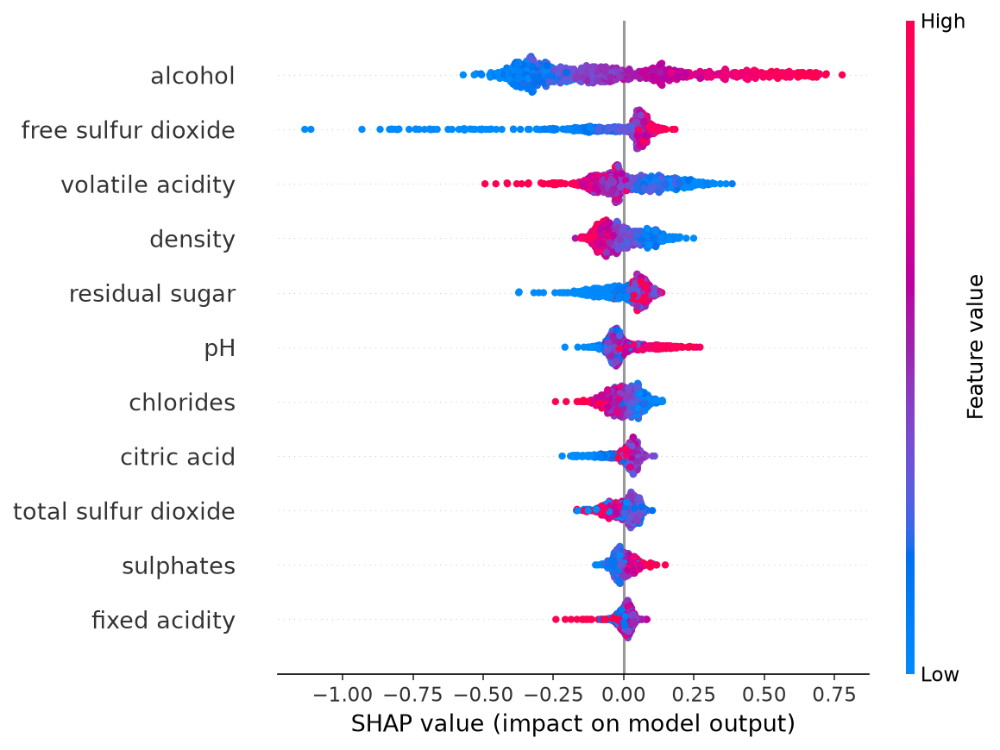

# Wine Innovation Engine

*From fermentation physics to a reformulated bottle of white wine.*

**[Open the live app](https://wine-innovation-engine-v2-pepie6aqsswrtshttltv7u.streamlit.app/)** 

A winemaker who wants a better bottle has two places to intervene: the process, which runs for
a few weeks in a tank, and the chemistry, which can be nudged afterwards in the cellar. This
project models both ends of that choice and asks which one actually moves quality.

Six models answer it, each one handing its output to the next. A fermentation twin built from
kinetics. A thermal check on whether a tank is really one vessel. A designed experiment over
the process. A quality model learned from 3,961 real wines. A feasibility filter that throws
out chemistries which could not legally or physically exist. And a constrained search for a
better version of a wine that already does.

## What it found

**Nitrogen runs out long before sugar does.** The twin exhausts assimilable nitrogen at roughly
110 h with about 150 g/L of sugar still in the tank. Every stuck fermentation in the design
space traces back to this, not to running out of substrate.

**A tank is not one vessel.** Top and bottom differ by 2.3 °C, which moves the finish by about
50 h while leaving final ethanol unchanged at roughly 121 g/L. The gradient costs time, not
alcohol.

**The process optimum is a direction, not a point.** Desirability peaks at the warm edge of the
tested window rather than inside it, so the finding is that warmer is better up to 27 °C, with
the caveat that the objective scores only time, rate and conversion.

**Quality is not linear in chemistry.** Tree models beat a linear baseline by well beyond fold
to fold noise, and the deployed Random Forest reaches R² 0.398 on held-out wines. That ceiling
is the dataset, not the tuning: a panel's median score is mostly driven by things 11 lab
measurements do not capture.

**And the conclusion the whole chain exists to reach:** given a real wine, an optimiser allowed
to change anything buys 1.74 quality points, almost all of it by raising alcohol from 9.1 % to
12.3 %. Restricted to what a cellar can actually adjust after fermentation, the same search
gains 0.02, which is nothing. Alcohol is an outcome, not a lever. The place to intervene is the
ferment, which is where Phase 1 started.

## Try it

The app is live at **[wine-innovation-engine-v2-pepie6aqsswrtshttltv7u.streamlit.app](https://wine-innovation-engine-v2-pepie6aqsswrtshttltv7u.streamlit.app/)**, or run it locally:

```bash
python -m venv venv && source venv/bin/activate
pip install -r requirements.txt
streamlit run app/streamlit_app.py
```

It is the front end for all six models: move the starting conditions of a ferment and
watch the ODEs re-solve, warm or cool a tank, test a process setting against the full
simulator, attribute a single wine's score with SHAP, edit a chemistry until the feasibility
layers accept it, and run the reformulation search under either scenario.

## The chain

| Phase | Question it answers | Where |
|---|---|---|
| **1** | What does a fermentation actually do over time? | `src/process/simulator.py` |
| **2** | What breaks when the tank is not well mixed? | `src/process/spatial.py` |
| **3** | Which process conditions are best, and how do we know? | `src/process/doe.py`, `r/` |
| **4** | Which chemistry drives perceived quality? | `notebooks/04` |
| **5** | Which chemistries are even possible? | `src/modeling/constraints.py` |
| **6** | How do we move a real wine toward a better score? | `src/modeling/reformulate.py` |

The first three phases are written as equations. The last three are learned from data. Phase 5
is the join between them, and it is what stops the second half proposing wine that cannot
exist.

## Phase 1. The fermentation twin

Five coupled ODEs, solved with `scipy.integrate.solve_ivp`:

```
dX/dt  = (μ - k_d) · X                # viable biomass
dXt/dt = μ · X                        # total biomass
dS/dt  = -(β·X / Y_es) - MNT·X        # sugar consumption
dN/dt  = -μ·X / Y_xn                  # nitrogen depletion
dE/dt  = β·X + MNT·X                  # ethanol production
```



The nitrogen panel carries the result. Nitrogen reaches zero at roughly 110 h while about
150 g/L of sugar is still in the tank.

Sugar is not the limiting nutrient. Grape must carries 150 to 300 g/L of it, which is plenty.
What runs out is yeast assimilable nitrogen. Viable biomass peaks exactly when nitrogen is
exhausted and then dies back, while fermentation carries on with the survivors.

A fermentation gets stuck here in two ways: nitrogen below about 80 mg/L, or a temperature high
enough that thermal death takes over, which happens sharply above 25 °C.

The parameters are checked against Coleman et al. (2007) Dataset 2. The model predicts a
maximum viable biomass of 3.59 g/L where the paper reports 3.5 g/L, a deviation of about 2.6 %,
and they hold up under nitrogen limitation, which is the regime that matters.

## Phase 2. Is the tank well mixed?

Phase 1 assumes one temperature for the whole tank. That is fair for small vessels and fails at
scale, so the assumption is worth testing rather than asserting.

The tank is cut into horizontal layers, each running its own kinetics at its own temperature.
Fermentation releases heat, the cooling jacket pulls it out at the base, and the open top loses
almost nothing, so the tank ends up warm on top and cold at the bottom.



The gradient changes the timing, not the destination. The warm top at 14.3 °C reaches dryness
about 50 h before the cold base at 12.0 °C, yet both land on the same final ethanol of roughly
121 g/L. Where time in tank enters the objective, a 50 h spread inside a single vessel is not a
rounding error.

The result is not a numerical artefact. Peak gradient across 10, 20, 40 and 80 layers gives
6.768, 6.769, 6.799 and 6.789 °C, so the grid is fine enough. Six physics tests cover this
module in `tests/test_spatial.py`.

## Phase 3. Design of experiments

Three objectives that genuinely conflict: high final ethanol, low residual sugar, and short
fermentation time. Warmer finishes faster and drier but risks killing the yeast. More sugar
yields more ethanol but a slower, stickier ferment.

A three factor Box Behnken design over temperature, sugar and nitrogen, fitted as second order
polynomials in R and combined with Derringer Suich desirability functions.

| T | S₀ | N₀ | pred. time | pred. peak rate | pred. conversion | **D** |
|---|---|---|---|---|---|---|
| 27 °C | 267.7 g/L | 320.3 mg/L | 104.1 h | 3.81 g/L/h | 0.983 | **0.987** |

Coded temperature lands exactly on its upper bound, so the optimum sits on a boundary rather
than in a basin. Warmer is better inside the tested window; 27 °C is not a peak.

The desirability function also has no aroma term. It scores time, rate and conversion, all of
which are process economics, while the sensory literature puts better aromatics in white wine
at cooler fermentations between 10 and 15 °C. A process optimal wine and a sensory optimal wine
are not the same wine, and this design optimises only one of them.

Two of the 15 design points failed to reach dryness, both at the low nitrogen level. That is
the Phase 1 mechanism showing up quantitatively.

## Phase 4. Predicting quality from chemistry

Real data enters here. The UCI white wine dataset, 4,898 rows reduced to 3,961 once duplicates
are removed, 11 lab measurements, and a quality score that is the median of at least three
assessors.

It is treated as regression rather than classification, because a 6 really is closer to a 7
than to a 3, and a classifier throws that ordering away.

The protocol is the actual deliverable: a 20 % test set held out and looked at once, scaling
fitted inside each CV fold so nothing leaks, nested cross validation for the tree models so the
reported score is not the tuning search grading its own homework, and every run logged to
MLflow with fixed seeds.

| Model | Test RMSE | Test R² |
|---|---|---|
| Ridge (linear baseline) | 0.745 | 0.27 |
| **Random Forest** (deployed) | **0.691** | **0.398** |
| XGBoost | 0.692 | 0.396 |

The trees beat the linear baseline by far more than fold to fold noise, which says something
chemical: the link between composition and perceived quality is not linear. Random Forest ships
over XGBoost not on RMSE, where the two are tied, but because it has fewer hyperparameters and
its search overfitted less.



The drivers make chemical sense, which is the real test for an interpretability layer. Alcohol
dominates and is the widest single effect. Free SO₂ comes second and is strongly asymmetric,
because a wine with very little of it is unprotected from oxidation and the model has learned
that cliff. Volatile acidity is third and negative, which is the vinegar fault.

## Phase 5. Which wines are even possible?

A model will happily score a wine that could not be sold or could not exist. Optimise over it
without saying so and it will invent one. Four layers keep the search honest.

| Layer | Constraint |
|---|---|
| **L0, legal** | total SO₂ at or below 200 mg/L, or 250 mg/L once sugar reaches 5 g/L; volatile acidity at or below 1.08 g/L (Reg (EU) 2019/934) |
| **L1, bounds** | every value inside the 1st to 99th percentile of the training wines |
| **L2, typicality** | Mahalanobis d² at or below 10.15, so the combination is typical and not just each value on its own |
| **L3, physical law** | density within 3σ of `1.00509 − 0.00126·alcohol + 0.00035·residual sugar`, σ = 0.00085 |

L3 does the most work, because density is not a free parameter. Alcohol makes wine lighter and
sugar makes it heavier, and the relationship is tight enough to fit. An optimiser allowed to
raise alcohol while holding density fixed is describing a liquid that does not exist.

## Phase 6. Moving a real wine

The inverse problem. Given a wine, find the composition that scores highest while staying
inside all four layers and without drifting far from where it started. Solved with differential
evolution, which is global, gradient free, and copes with the non linear constraints.

Two scenarios on the same wine, number 536, currently predicted at 5.14.

| Scenario | What may move | Quality | Gain |
|---|---|---|---|
| **Vintage design** | everything | 5.14 to **6.88** | **+1.74** |
| **Cellar intervention** | only free SO₂, sulphates, citric acid | 5.14 to **5.16** | **+0.02** |

The gap between those two rows is the finding. Let the optimiser change anything and it buys
1.74 points, almost all of it by raising alcohol from 9.1 % to 12.3 %. Restrict it to what a
winemaker can adjust after fermentation and the gain collapses to 0.02.

That is not a failure of the optimiser but the answer itself. Quality in this dataset is mostly
decided by alcohol and density, and those are set at harvest and during fermentation, not in
the cellar.

Which closes the loop back to Phase 1. If alcohol is what matters and alcohol is set during
fermentation, then the lever is the process, which is exactly what Phase 1 simulates and
Phase 3 optimises.

## Also in here

Two layers sit outside the main spine. Notebook 07 runs metabolomics on a public ¹H-NMR and
GC-TOF study of seventeen white wines, with PCA, PLS-DA, permutation testing and VIP scores.
Notebook 08 builds a knowledge graph linking process parameters to chemistry to sensory
outcome.

## What this does not do

There is no full CFD. Phase 2 is 1D conduction with an effective diffusivity standing in for
convection. It shows the gradient matters. It does not resolve the flow field.

There is no pure error estimate either. The Box Behnken centre point is replicated three times,
but the simulator is deterministic so the replicates are identical. The lack of fit F tests are
therefore meaningless, and fit is judged on R² and residual plots instead.

An R² of about 0.40 is a ceiling rather than a bug. Sensory quality is a median of human
scores, and roughly 60 % of its variance is not in these 11 measurements, which makes the
reformulation results directional rather than promised scores.

Finally, the quality model is observational. It learned correlations, so optimising over it
assumes those relationships survive intervention. The constraint layers stop physically absurd
proposals. They cannot make the model causal.

## Repository layout

```
app/              streamlit_app.py (shell) and app_pages/ (one page per phase)
.streamlit/       config.toml, theme and chart palettes
src/process/      simulator.py, spatial.py, doe.py          (Phases 1 to 3)
src/modeling/     constraints.py, reformulate.py            (Phases 5 and 6)
r/                rsm_fit.Rmd, desirability_optimize.R      (Phase 3 statistics)
                  install_packages.R, the R side of requirements.txt
notebooks/        the work behind each phase
scripts/          run_phase6_batch.py, export_phase4_artifacts.py
tests/            pytest suite, run with pytest -q
results/          figures, tables, and the committed inputs the app runs on
reports/          executed notebooks exported for reading
data/raw/         UCI white wine quality dataset
data/processed/   NMR and GC-TOF metabolomics summary (notebook 07)
```

## Reproducing

```bash
python -m venv venv && source venv/bin/activate
pip install -r requirements.txt
pytest                                   # physics and smoke tests
streamlit run app/streamlit_app.py
```

The Phase 3 statistics are in R. To re-run that half:

```bash
Rscript r/install_packages.R
Rscript -e 'rmarkdown::render("r/rsm_fit.Rmd")'
```

Every number here is traceable to a logged MLflow run. The tracking store is not committed,
because a binary SQLite database does not belong in version control and the trained forest is
25 MB on disk. So that a clone is still useful, everything the app reads is exported into
`results/` instead: the four constraint artifacts, the deployed Random Forest compressed to
5.6 MB, and the finished Phase 6 searches. The loaders prefer those files and fall back to
MLflow when they are missing, so the app behaves the same either way and starts about four
times faster.

Re-run the export after retraining:

```bash
venv/bin/python scripts/export_phase4_artifacts.py
```

## Data

The quality model is trained on the UCI white wine quality dataset (Cortez et al., 2009),
4,898 Portuguese *vinho verde* wines with 11 physico-chemical measurements and a sensory score.

The metabolomics notebook uses a public study of seventeen white wines analysed by both ¹H-NMR
and GC-TOF, carried out in the Viticulture & Enology Department at UC Davis and released
through the Metabolomics Workbench (experiment 421340, *Vitis vinifera*). The repository holds
only the summary export the notebook reads.

## References

Bailey & Ollis, *Biochemical Engineering Fundamentals* · Bogard et al. (2020) · Boulton (1979) ·
Coleman et al. (2007) · Cortez et al. (2009) · Derringer & Suich (1980) · Georgiev et al. (2024) ·
Karimi et al. (2020) · Lundberg & Lee (2017) · Miller & Block (2020) · Monod (1949) ·
Shener et al. (2007) · Thuy et al. (2023) · Reg (EU) 2019/934
